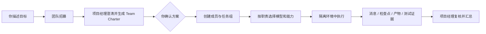

# Goal-Guided Brain

> **把一个目标交给项目经理，让一支由多个模型驱动的智能体团队帮你推进到可验收交付。**

Goal-Guided Brain（简称 **GGB**）是一个面向个人的多团队 AI 协作工作台。你从一个团队招募对话开始，说清楚想完成什么；项目经理会和你多轮澄清目标、交付物、约束和权限，再决定需要几个智能体、每个成员负责什么、使用哪个模型和哪些能力。确认方案后，团队可以持续拆解任务、跨团队协作、保存上下文，并把结果和验证证据带回给你。

GGB 的稳定内核是团队职责、模型路由、能力绑定、个人习惯、项目知识、权限边界、任务状态和交付证据。模型可以替换，团队和工作流可以长期沉淀。它适合开发、运维、产品规划、资料整理，以及需要多个专业角色协作的长期项目。

完整的产品定位、架构、数据模型、接口、权限边界和迭代路线见 [项目全景说明](docs/project-overview.md)。

## 30 秒理解 GGB

```text
你描述目标
  → 团队招募与项目经理多轮澄清
  → 生成 Team Charter（团队规模、职责、模型、能力和交付物）
  → 你确认方案
  → 团队成员按职责执行，项目经理跟踪和汇总
  → 任务、产物、测试和验收证据回到团队空间
```

GGB 的主入口是“团队招募”。你不需要先判断应该找产品、开发还是运维助手；项目经理会先理解问题，再组建合适的团队。一个团队可以长期负责一个项目，也可以为开发、运维、产品或不同项目分别建立多个团队。每个团队都有自己的成员、模型、能力、工作目录和自治边界。

团队的新任务使用自己的项目目录。修改目录后，项目经理会开启新会话，已有成员会话仍保留原目录；输入区会显示当前使用的位置，点击即可进入对应团队设置。隔离执行的实际副本位置可以在任务详情查看。

| 你只需要             | GGB 会负责                                     |
| -------------------- | ---------------------------------------------- |
| 说清楚想达成的结果   | 和你澄清需求、约束、优先级和验收标准           |
| 确认团队方案         | 创建成员、绑定职责、模型、Skill、MCP 和 Plugin |
| 查看进展并做关键决策 | 拆解任务、调度执行、跨团队协作并汇总结果       |
| 检查最终交付         | 展示产物、测试、验收状态和可追溯证据           |

## 核心能力

- **团队招募**：直接描述目标，和项目经理多轮讨论，生成可确认的 Team Charter。
- **多团队协作**：为开发、运维、产品或不同项目建立独立团队，团队之间通过项目经理受控委派；每次委派都会在源团队和目标团队留下关联记录，完成或失败结果会回传源团队。
- **团队模板与复制**：把已确认团队的职责、成员组合、模型和自治配置保存为模板；新团队只复制配置，不复制历史消息、招募会话、任务、草稿或附件，并在创建时重新确认名称、目标和执行边界。
- **模型自由切换**：按团队、角色或单次任务选择 DeepSeek、Gemini、Claude、Codex/OpenAI、Kimi 等模型。
- **路由可解释**：任务会保留实际供应商、模型、候选能力和自动回退事件，便于判断为什么选中或切换模型。
- **事件流可增量读取**：执行详情和团队空间都提供带游标的 SSE 实时流；团队消息、任务委派、执行事件、交付证据和待确认事项会触发同一条团队刷新流，断线后可从游标补齐，长任务无需刷新页面就能看到变化。
- **模型运行指标**：模型管理按真实执行记录汇总尝试次数、逻辑任务、完成/失败、回退、延迟、Token、费用、验证和交付结果，并可按时间范围（全部、最近 7 天、最近 30 天）、任务类型、团队、助手、供应商和模型筛选；同时展示当前范围内的验收证据覆盖率、验证通过率、所有者决策率、按团队/任务类型覆盖率、按日趋势，以及按任务类型比较最终状态、失败尝试、资源消耗和成本。
- **能力管理**：安装、固定、启用和回退 Skill、MCP 与 Plugin；智能体只能使用已绑定能力。
- **可恢复执行**：任务组、子任务、消息、检查点、产物、预算、租约和远程节点状态都会持久化。
- **长对话阅读**：默认显示最近 30 轮，按需加载更早对话；加载历史和实时更新保持阅读位置，回到最新可收起已展开历史，切换成员会话时重置阅读窗口。使用标题区的搜索入口，可查找当前对话的需求和回复，包括尚未展开的历史，并直接定位原文。
- **任务历史治理**：已结束且状态明确的任务可归档，默认列表保持清爽，也可以随时展开历史恢复查看。
- **可恢复的跨团队派发**：协作目标、验收标准和目标团队按来源团队保存在当前浏览器；修改预览需重新审阅。回执丢失时可刷新后重试确认，沿用同一请求 ID 避免重复创建任务；任务与双方协作记录原子保存。
- **团队生命周期**：已确认团队可以安全归档，历史消息、任务、交付证据和知识引用继续保留；有进行中任务时会阻止归档，归档团队可以从侧栏恢复并继续工作。
- **团队自治边界**：每个团队可以限制任务拆解层级、活跃任务数和累计 Token 预算；接近预算会预警，达到边界会暂停自治并生成待处理事项。
- **多设备草稿同步**：招募和团队输入按团队/角色保存；跨团队协作表单、追问引用和收尾说明也可换设备继续。本机副本支持离线恢复，对话草稿可合并非重叠修改；协作表单有冲突时核对整份内容，避免目标和需求被错误组合。
- **统一团队时间线**：团队页把消息、任务、执行事件、产物、验收证据和所有者交付决定按时间串起来，进入团队动态时按需读取，支持消息、执行、证据、风险筛选和加载更早动态；筛选在服务端分页前执行，旧证据不会被近期消息遮住。失败可重试，点击记录可以回到任务详情。
- **知识新鲜度闭环**：团队知识支持版本和复核截止日期；即将过期或已过期的知识会进入后台任务风险收件箱，点击即可回到知识编辑并更新复核日期。
- **通知与风险入口**：需要你处理页面同时聚合持久通知、待处理事项和跨团队风险，支持按团队/类型筛选，并能直接回到对应任务、团队或知识编辑；团队计划逾期会自动生成去重提醒，完成或改期后自动收敛。
- **目标与计划层**：维护团队目标和里程碑，关联本团队任务并查看实时交付状态；从里程碑直接打开执行记录进行验收。阶段进度与实际验收分别显示；运行中的项目经理可读取计划、维护里程碑，并在关联任务全部验收后完成阶段。计划支持截止日期、风险偏好、预算和多设备版本校验。
- **团队工作区隔离**：团队默认在隔离目录执行；创建团队时可以明确选择 Git worktree、快照或共享目录。
- **个人工作习惯**：保存语言、时区、语气、详细程度、长期规则和项目知识。
- **可选结构化判断**：TypeSafe System One 可用于路由、风险预评估和人工复核分流，不会替代聊天模型。
- **跨平台 CLI**：通过 `ggb` 在 Windows、macOS 和 Linux 上直接执行或持续对话。

## 工作方式



全新工作区只初始化一个由项目经理负责的需求草稿，不会预先创建已确认团队。打开或刷新草稿会进入“团队招募”；已有团队继续保留原有身份和成员。

确认 Team Charter 之前，系统不会把成员说成已经创建，也不会自动分派执行任务。高风险的发布、部署、删除、发送和外部写入仍需要明确授权或人工复核。

同一团队的项目经理按轮次处理消息。上一轮处于排队或执行中时，新的消息会被记录为 `blocked` 并返回 `409`，避免两个项目经理实例同时修改同一份招募上下文；团队对话会显示阻塞原因，上一轮结束后可以直接点击“重新发送”继续原会话。

团队之间的协作也由项目经理完成。源团队需要开启协作，并允许目标团队；目标团队需要处于已确认且活动状态。目标团队会用自己的项目经理、模型、能力、预算和工作目录创建独立任务与会话，源团队动态会保留委派记录并显示目标任务状态；目标团队完成或失败后，结果状态和摘要会回传为源团队消息。网页 API 与编排 MCP 共用原子提交和重试恢复逻辑；同一请求重试不会重复派发，不同来源任务的相同幂等键不会覆盖彼此。智能体发起协作还需开启自动协作并持有有效执行租约。

“最近协作”可以展开完整消息、加载更早记录。原任务结束后，可选择“继续协作”，填写追问或新的交付要求；发送前展示关联记录，服务端自动附上原请求和回传结果，创建独立后续任务。已有草稿先选择保留或替换，未确认送达的请求保持锁定。继续协作不会替代原任务的交付验收。协作目标、验收标准、引用和处理说明保存为服务端草稿，显示同步状态并支持失败重试。发送前先同步固定请求；另一设备可以继续确认同一请求。回执丢失时发起设备保留待确认内容，迟到的确认不会清掉后续草稿。

每条有效协作提供“查看协作链路”：你可以跟踪产品团队交给开发团队、开发团队再交给运维团队的完整关联，查看每次请求由哪个任务发起，并回到对应对话。原请求、追问和智能体转派同时保留；多个需求共享后续工作时，显示各个起始请求且不重复计数。执行、验收和收尾分别统计，支持分页、定位、刷新和失败重试。此汇总供工作台所有者查看；智能体仍只能读取自己获准访问的协作。无法确认的历史来源会明确提示，各次请求仍分别验收和处理。

来源团队的“处理协作”提供明确收尾：当前交付验收通过后可“确认完成”；也可以对已结束的任务填写原因“结束跟进”，这不会改变交付验收。两种决定都留有记录，结果或验收证据变化会提示重新复核。已关闭请求需先重新打开才能继续追问，重新打开不会自动执行任务。关联的后续请求各自处理。

智能体可用 `list_team_collaborations` 分页查看本团队发出或收到的协作，按跟进中、已关闭、需复核或关联缺失筛选。`read_team_task` 只允许读取本团队实际委派且仍获准的任务，并返回收尾状态及可否追问；目标团队的其他工作和内部消息不会被一并暴露。列表中的历史请求与已收到回传保留在本团队，不能据此越过已撤销的访问权限。收尾决定仍由你作出。

## 交付和验收

任务的 `completed` 只表示执行过程结束，不等于已经验收通过。团队页的统一时间线会把消息、任务、执行事件、产物、验收证据和所有者决定按发生时间串起来；任务详情会保存并展示：

- 执行目录类型、路径、分支和当前状态。
- 实际使用的模型、候选模型、能力要求和自动回退原因。
- 未提交变更，以及可选的内部 Git 提交。
- 最近一次验证命令、输出、退出结果和验证产物。
- 任务事件、检查点、交付产物和模型用量。
- 跨团队委派的源团队记录、目标团队记录及其关联任务 ID。
- 当前需求版本、验收标准和最新验证证据；所有者可以明确“通过交付”或“退回复核”，旧需求版本的决定会自动失效。

可以在后台任务或团队动态中打开执行详情，查看变更并运行验证。团队动态会直接显示每个任务的验收状态和证据数量，验证结果会作为独立证据保存；任务仍在运行、目录被隔离或状态未知时，提交和验证操作会自动受限。项目经理的文字总结不能替代这些可检查记录。

在“团队动态 → 目标与里程碑”中，点击“关联任务”可以搜索并选择本团队的执行任务。每个里程碑显示已验收数量和每项任务的执行／交付状态；点击任务卡片可查看证据、通过交付或退回复核。里程碑的手动完成标记不会替代任务验收，需求版本变化导致的旧验收失效也会反映在计数中。项目经理通过 `read_team_plan` / `upsert_team_milestone` 使用同一份计划，更新会显示原因和版本；后台出现新版本时，页面会提示加载并保留当前输入。智能体不能用计划工具修改预算、改变权限或替用户验收。

任务状态和交付状态分开记录：`completed` 只代表执行结束；当前版本验证通过后进入“待你验收”，所有者通过后才进入“已交付”，退回则进入“已退回复核”并生成待处理事项。需求被修改后，旧验证和旧验收决定会失效，必须重新验证。

## 快速开始

要求 Node.js `22.13+`（建议 `24+`）和 Git。

```bash
npm install
npm run build
npm start
```

首次连接会先读取团队和工作位置，再开放操作。连接失败或超时可直接重试；使用中断连会保留当前内容与草稿，并提示数据尚未更新。

打开 <http://127.0.0.1:3088>。API 默认监听 `127.0.0.1:3089`。开发模式使用：

```bash
npm run dev
```

可以通过环境变量覆盖本地服务配置：`WORKBENCH_UI_PORT`、`WORKBENCH_API_PORT` 和 `WORKBENCH_DATA_DIR` 分别控制网页端口、API 端口和工作台数据目录。CLI 会话目录另由 `DSH_SESSION_DIR` 控制。

停止本地服务：

```bash
npm run stop
```

首次使用建议：

1. 在“模型管理”中初始化加密凭据库，配置至少一个普通聊天模型。
2. 确认工作目录和 DSH 执行引擎可用。
3. 返回“团队招募”，直接描述你要完成的目标。
4. 检查项目经理生成的 Team Charter、成员职责、模型和能力绑定。
5. 点击“确认创建团队”，再开始执行任务。

## CLI：`ggb`

项目品牌命令是 `ggb`。`dsh`、`dsh-workbench` 和 `goal-guided-brain` 保留为兼容别名。

```bash
npm link

export DEEPSEEK_API_KEY=...
ggb run --provider deepseek --model deepseek-chat "分析当前项目风险"
echo "设计一个缓存方案" | ggb run --provider claude
ggb chat --provider gemini --session personal
printf '{"type":"prompt","id":"p1","text":"检查项目"}\n' | ggb rpc --provider deepseek --session automation
ggb events <task-id> --once --json
ggb events --team <team-id> --once --json
ggb providers
ggb doctor --json
ggb doctor --node-config ./node.json --strict --json
ggb node --control-url https://workbench.example.com --workspace project=/absolute/path --print-config
```

CLI 支持：

- `ggb run`：执行一次任务，可使用 `--system`、`--no-stream`、`--json`、`--session` 和 `--continue`。
- `ggb chat`：进入持续对话，支持 `/new`、`/model`、`/session`、`/help` 和 `/exit`。
- `ggb rpc`：使用 stdin/stdout JSONL 驱动会话，支持 `prompt`、`follow_up`、`set_model`、`abort`、`session` 和 `ping`，输出稳定的 `turn_start`、`text_delta`、`turn_end`、`model_changed`、`aborted` 和 `error` 事件。
- `ggb events`：订阅工作台任务或团队的 SSE 事件流；任务使用 `ggb events <task-id>`，团队使用 `ggb events --team <team-id>`，都支持 `--after` 游标断线恢复、`--once` 读取历史后退出和 `--json` JSONL 输出，适合终端监控和自动化脚本。
- `ggb providers`：查看普通模型预设和可选 TypeSafe 后端。
- `ggb doctor`：检查 Node.js、平台、会话目录、Git、模型凭据和本地工作台服务；传入 `--node-config` 时还会验证控制端地址、节点数据目录和工作目录映射。服务未启动只会给出提醒，不影响直接调用模型。`--strict` 把警告也视为失败并设置非零退出码，适合部署门禁；`--json` 输出适合脚本和 CI 读取的报告，绝不会打印密钥或节点身份。
- `ggb decide`：向 TypeSafe 发送结构化 `state` 和 `questions`，只返回 JSON 判断结果。
- `ggb node`：启动跨平台远程执行节点 worker。通过 `--control-url` 和可重复的 `--workspace 名称=本机绝对路径` 接入控制面；`--pair` 用于首次配对，`--print-config` 只输出不含身份和 token 的安全配置。

网页中的普通模型选择器不会把 TypeSafe 当作聊天模型；TypeSafe 只通过 `ggb decide`、管理页探测和编排 MCP 的 `evaluate_decision` 使用。

会话默认保存到 `~/.dsh/sessions`，可用 `DSH_SESSION_DIR` 覆盖。密钥只从环境变量或一次性的 `--api-key` 读取，不会自动写入会话文件。

Windows PowerShell 示例：

```powershell
$env:GEMINI_API_KEY = '...'
ggb run --provider gemini "总结这个项目"
```

## 模型配置

普通模型可在网页“模型管理”中保存到加密凭据库，也可以在 CLI 中通过环境变量使用：

| 供应商       | 环境变量                             |
| ------------ | ------------------------------------ |
| DeepSeek     | `DEEPSEEK_API_KEY`                   |
| Kimi         | `KIMI_API_KEY` 或 `MOONSHOT_API_KEY` |
| Gemini       | `GEMINI_API_KEY` 或 `GOOGLE_API_KEY` |
| Claude       | `ANTHROPIC_API_KEY`                  |
| Codex/OpenAI | `CODEX_API_KEY` 或 `OPENAI_API_KEY`  |

网页模型管理支持 DeepSeek、OpenAI Chat Completions、OpenAI Responses 和 Anthropic Messages。供应商配置包括基础地址、凭据引用、模型列表、上下文长度、工具能力、视觉能力和路由优先级。

保存供应商后，可以在“模型管理”的供应商列表中点击同步按钮，从该供应商的 `/models` 接口读取最新模型 ID。同步会保留已经确认过的工具、视觉和价格信息，并过滤当前聊天执行引擎不能直接使用的图片、音频、实时和其他专用模型；新发现的模型默认按纯文本模型处理，确认支持工具后再在管理页探测并启用工具能力。对话选择器同时显示模型名称和真实 ID，避免展示名与实际请求模型混淆。

模型管理页的运行指标读取 `/api/metrics/models`，把一次重试视为新的执行尝试、把共享 `groupId` 视为同一个逻辑任务，并显示候选路由决定、回退、耗时、Token、费用和当前版本的验证/交付状态。页面支持“全部时间 / 最近 7 天 / 最近 30 天”窗口和规划、开发、产品、运维、调研、验证、复核、协作、通用任务类型，筛选会同时约束任务聚合、验收证据质量统计、按日趋势和任务类型运行对比；对比卡片中的完成/失败是逻辑任务最终状态，失败尝试单独统计，没有价目数据时费用显示为“未知”。

时间、团队和任务类型可以直接筛选；助手、供应商和模型通过“更多筛选”展开。收起高级筛选仍保留已选条件，并提供条件标签和重置入口。手机端摘要采用双列布局，已验证 320px 和 393px 窄屏交互。

### TypeSafe 是可选的

[TypeSafe System One](https://docs.typesafe.ai/introduction) 是结构化判断接口，不是聊天或代码生成模型。GGB 将它作为独立的可选决策后端：

```bash
export TYPESAFE_API_KEY=...
ggb decide \
  --state '{"goal":"发布新版本","constraints":["周五前完成"]}' \
  --questions '{"urgent":{"type":"noul","instructions":"Is this urgent?"}}' \
  --json
```

未配置 TypeSafe 时，普通模型、团队招募和开发任务照常运行。TypeSafe 的结果不能代替事实验证、用户确认或高风险操作审批。网页配置建议基础地址为 `https://api.typesafe.ai/v1`，模型使用 `jev-latest`。

## 能力中心

GGB 的 Skill、MCP 和 Plugin 采用显式绑定：

1. 搜索或导入能力来源。
2. 固定版本并保存内容摘要。
3. 检查依赖、健康状态和兼容性。
4. 绑定到角色或团队成员。
5. 任务启动时只注入已绑定且启用的能力。

运行中的智能体可以通过编排 MCP 查看本次实际能力，并调用已经获准的 Plugin 命令。它不能从任务中自行启用未绑定能力，也不能通过消息扩大权限。

项目经理在团队招募阶段还可以通过 `list_capability_catalog` 查看已启用能力的来源、兼容性诊断、命令/助手模板/MCP 组件摘要和风险摘要；运行中的助手通过 `list_capabilities` 查看同一份实际绑定快照。风险分为 `low / medium / high`，并列出网络、凭据、本地进程、命令、Hook 等原因以及 `requiresReview` 标记。中/高风险能力在启用和绑定前必须由负责人逐项确认，确认会绑定能力指纹并写入审计记录；风险信息只用于解释和人工复核，不会自动扩大助手权限；显式声明为只读且不使用凭据的远程连接可以保持低风险。

团队成员只有在能力中心已启用、固定并绑定到该角色后，才能在任务中看到对应 Skill、MCP 或 Plugin。能力中心的安装、健康检查、启停、版本回退和角色绑定不会改变已经运行任务的权限；新权限从下一次任务启动时生效。

## 数据和安全

默认数据目录为 `~/.dsh-workbench/`：

```text
workspace.sqlite       团队、任务、消息、知识、配置和调度
vault.json             Argon2id + AES-256-GCM 加密凭据库
runs/<taskId>/         隔离的执行目录和日志
capabilities/          固定版本的 Skill / Plugin 内容
backups/               SQLite 一致性备份及凭据副本
```

任务使用实例凭证、执行租约和心跳。租约失效、任务暂停、取消或预算超限后，执行权限会被撤销；迟到结果不能覆盖当前状态。MCP 写操作按实例、工具和参数授权，未知的外部操作结果不会自动重试。

凭据库主密码只通过管理页输入，或在受控的服务进程中使用 `WORKBENCH_VAULT_PASSWORD` 注入；GGB 不会把主密码写入数据目录。升级旧版本时发现的明文 `.vault_pass` 文件会被删除，请改用环境变量或启动后在管理页解锁。

公开部署必须使用 HTTPS、登录认证和反向代理，不要直接暴露 3088/3089。Linux 常驻服务、远程节点、Windows 原生/WSL2、备份和恢复请查看 [部署说明](deploy/README.md)。

## 文档入口

- [项目全景说明](docs/project-overview.md)：完整产品、架构、接口、权限和路线图。
- [个人智能体方向](docs/personal-agent.md)：个人偏好、记忆边界和模型分工。
- [团队智能体空间](docs/team-agent-workspace.md)：团队招募、成员职责和跨团队协作。
- [手机端交互规范](docs/mobile-interaction.md)：当前工作、团队切换、输入键盘、附件和移动端验收边界。
- [产品质量标准](docs/product-quality-bar.md)：视觉、交互、代码、测试和本地交付门槛。
- [Claude Code 与 Pi 设计调研](docs/claude-pi-design-review.md)：可借鉴的 Agent 设计。
- [阶段计划与发布边界](docs/phase-2-plan.md)：已交付能力和未完成验收项。
- [部署说明](deploy/README.md)：控制平面、执行节点、WSL2 和 HTTPS。
- [备份恢复说明](deploy/backup-restore.md)：SQLite 与加密凭据恢复。
- [依赖安全说明](docs/dependency-security.md)：依赖和第三方代码边界。

项目全景说明还记录了任务详情接口、执行目录验收动作和团队消息串行规则；README 只保留最常用的产品和启动说明。

## 开发和发布验证

```bash
npm run quality:lines
npm run format -- --check
npm run lint
npm run typecheck
npm test
npm run test:e2e
npm run build
```

`npm run test:e2e` 会启动隔离的 API/UI 服务，在桌面和移动 Chromium 尺寸下验证团队招募、招募会话跨设备同步、团队模板复制边界、统一团队时间线筛选与分页、团队事件流实时接收、跨团队统一时间线浏览、跨团队风险筛选与延迟响应隔离/分页重试、知识复核风险直达知识编辑、通知管理页聚合风险并保留直接处理入口、目标与里程碑计划维护、团队协作控制台、协作目标团队白名单、团队级自治暂停/恢复与拆解/任务/Token 限额、团队归档/恢复与进行中任务拦截、助手编辑器的能力兼容与绑定范围、能力中心的中高风险能力确认与审计、Team Charter 绑定中高风险能力前的逐项确认与绑定审计、团队专属知识隔离与知识过期提示、浏览器本地与服务端草稿跨刷新恢复、双团队草稿隔离、多设备草稿自动合并与冲突选择、工作区视图恢复、模型切换、模型运行指标时间范围/任务类型/团队筛选/按日趋势与验收证据质量摘要、对话上滑阅读/回到最新、失败任务恢复、任务事件增量更新（含 SSE 实时流）、任务归档/恢复、任务中心按团队/状态筛选、交付验收决定、批量复核失败提示、待处理事项关联执行、普通事项处理闭环与持久通知、定时任务失败通知、真实二进制附件、桌面团队名称/职责搜索、手机端当前工作快速切换（支持按团队名称/职责搜索）/底部主导航/完整导航抽屉/触控文件入口/底部设置面板/键盘态布局、执行节点配对向导、跨平台启动命令、节点详情状态刷新、节点失联提醒与恢复和撤销后重新配对；最近一次全量验证为 244 个浏览器运行，后端确定性套件为 254/254，并包含两个团队连续 20 次交替消息的归属压力测试。首次运行若本机没有 Playwright 浏览器，请执行 `npx playwright install chromium`。测试使用临时数据库、本地确定性模型和 MCP fixture，不调用付费模型。每次功能迭代都应补充对应验证并检查 `git diff --check`。

状态读取性能可用 `node tests/benchmark-state.mjs 10 20` 复测：在临时数据库创建 10 个团队、每队 20 个任务，输出生成耗时、HTTP 耗时、响应体积和集合读取次数，不调用付费模型。共享任务和团队集合在一次状态响应中只读取一次；索引不跨请求保存，完整历史仍然可用。浏览器后台刷新使用 ETag 校验，状态未变化时返回无正文的 304；变化时可按记录 ID 传输增量，浏览器保留完整历史。手动重试和操作后的刷新仍获取当前视图的完整状态。网页通过 `X-GGB-State-View: workbench` 延后读取各团队消息与时间线，任务正文与检索范围保持完整；不带该头的 API 客户端保持原完整响应。10 团队/200 任务的首屏状态正文由 1,158,429 降到 483,069 字节，20 团队/800 任务由 3,457,309 降到 1,883,589 字节。这是隔离基准的正文体积，不是手机交互耗时。基准也会输出未变化请求的正文总字节数，以及单任务更新的增量体积和耗时，并核对合并结果与完整快照一致。

```text
https://github.com/lianjiexu08-ui/Goal-Guided-Brain.git
```

当前项目仍在持续迭代中。真实 Linux、Windows/WSL2、云端 HTTPS、节点离线调度和生产模型质量需要在目标环境中单独验收，不能用本机测试代替。

仓库的 GitHub Actions 会在每次主分支推送和 Pull Request 上，用 Node.js 22 和 24 分别运行 Ubuntu、macOS、Windows 的 lint、类型检查、后端/CLI 测试、`ggb doctor` 和生产构建，并在 Ubuntu 上运行桌面/移动 Chromium 回归。这个矩阵是跨平台兼容性门禁，不能替代真实 Windows/WSL2 节点、HTTPS 和离线调度验收。
