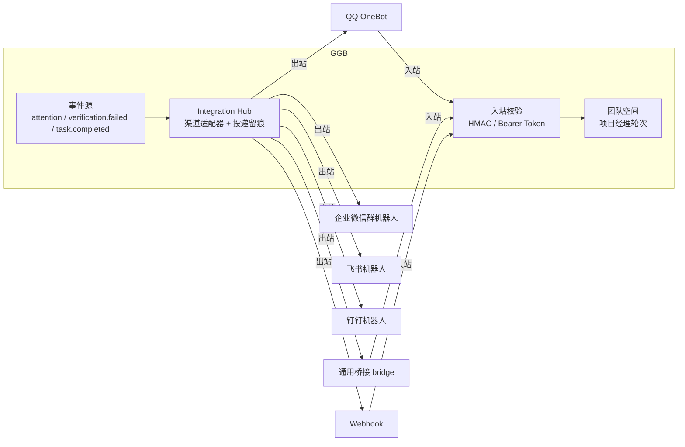

# 集成出口与外部聊天接入指南

GGB 通过**集成出口层**把工作台事件推送到外部渠道，并让外部渠道（QQ、微信、Webhook 等）把消息发回团队空间，由项目经理接手处理。本文是配置与接入手册；接口定义见 `server/integrations.mjs`。

## 概念



- **出站**：工作台事件 → 已启用且订阅了该事件的集成 → 渠道适配器 → 外部。
- **入站**：外部消息 → `/api/integrations/:id/inbound`（免登录，密钥自校验）→ 绑定团队的 owner 消息 → 触发项目经理轮次。
- **留痕**：每次出站投递写入 `integration-events`（状态、错误、响应码，上限 500 条），`GET /api/integrations/:id/deliveries` 查询。

## 支持的渠道

| 类型 | 出站 | 入站 | 说明 |
| --- | --- | --- | --- |
| `webhook` | ✅ JSON 信封 + HMAC 签名头 | ✅ HMAC 校验 | 通用 HTTP 出口/入口；签名头 `X-GGB-Signature`（对原始请求体 sha256-hex） |
| `wecom-bot` | ✅ 企业微信群机器人 | ❌ | config.url 为完整机器人 webhook 地址 |
| `qq-onebot` | ✅ OneBot v11 HTTP | ✅ Bearer access token | 需 OneBot 实现（NapCat / LLoneBot / Lagrange） |
| `feishu-bot` | ✅ 飞书自定义机器人 | ❌ | config.url 为完整 webhook 地址 |
| `dingtalk-bot` | ✅ 钉钉自定义机器人（支持加签） | ❌ | config.secret 为加签密钥 |
| `bridge` | ✅（可选 URL） | ✅ Bearer token | **通用桥接渠道**：QQ/个人微信等无原生 webhook 平台的标准入口 |
| 自定义 | ✅ | — | `service.registerChannel(type, { send })` 运行时注册，`channel` 字段可覆盖内置适配器 |

订阅事件：`attention`（待处理事项）、`verification.failed`（验证失败）、`task.completed`（任务终态）。

## API 速查

```bash
# 创建（owner 登录态）
POST /api/integrations
{"type":"qq-onebot","name":"QQ 群","config":{"url":"http://127.0.0.1:3000","qqTargetType":"group","qqTargetId":"123456","accessToken":"tok","teamId":"<teamId>"},"events":["attention","task.completed"]}

GET  /api/integrations              # 列表（密钥掩码，只显示尾 4 位）
GET  /api/integrations/:id
PUT  /api/integrations/:id          # 回传掩码密钥不会覆盖真实值
DELETE /api/integrations/:id
POST /api/integrations/:id/test     # 发送测试消息
GET  /api/integrations/:id/deliveries

# 入站（外部渠道调用，不需要登录态）
POST /api/integrations/:id/inbound
# webhook：请求体原样参与 HMAC 校验，格式 {"text":"...", "sender":"昵称"}
# qq-onebot / bridge：Authorization: Bearer <accessToken>，格式 {"text":"..."}
```

入站消息会以 owner 身份进入绑定团队空间，并触发项目经理轮次（与网页团队消息相同的 409 约束：PM 上一轮未结束时拒绝）。

## QQ 接入（个人 QQ / QQ 群）

QQ 官方不提供个人号 webhook，需要 OneBot 协议实现做桥：

1. 部署 [NapCat](https://github.com/NapNeko/NapCatQQ) 或 LLoneBot，登录 QQ，开启 **HTTP Server**（如 `http://127.0.0.1:3000`），设置 access token。
2. 在 GGB 创建集成：`type: "qq-onebot"`，`config.url` 填 OneBot 地址，`qqTargetType: "group"|"private"`，`qqTargetId` 填群号/QQ 号，`accessToken` 与 OneBot 一致，`config.teamId` 填要接入的团队空间 ID。
3. **入站（QQ → GGB）**：在 OneBot 侧配置 HTTP POST 上报地址为 `http://<ggb-host>:3089/api/integrations/<id>/inbound`；NapCat 收到的每条群消息会 POST 过来，body 需为 `{"text":"消息内容","sender":"QQ昵称"}`（部分实现需要用过滤器/脚本转换 OneBot 事件格式）。
4. 用 `POST /api/integrations/:id/test` 验证出站；在 QQ 群里 @机器人 发消息验证入站。

## 微信接入

**企业微信（推荐，官方支持）**：群聊里添加"群机器人"，复制 webhook 地址，创建 `type: "wecom-bot"` 集成即可出站。入站可用 `bridge` 渠道对接企业微信应用的回调（需自行处理企业微信的加解密协议）。

**个人微信**：官方无 API，通过桥接程序：

1. 部署 wechaty / WeChatFerry 等桥，登录微信。
2. GGB 创建 `type: "bridge"` 集成：设置 `accessToken`（自定义随机串）与 `config.teamId`；出站 URL 可留空（仅入站）或填桥的推送地址。
3. 桥收到微信消息后 POST `http://<ggb-host>:3089/api/integrations/<id>/inbound`，Header `Authorization: Bearer <accessToken>`，body `{"text":"...","sender":"微信昵称"}`。
4. GGB 的回复通过出站事件推给桥（若配置了 `config.url`），由桥转发回微信会话。

## 安全边界

- 入站端点**不经过工作台登录态**，完全依赖每个集成的密钥；密钥务必使用长随机串，并仅在可信网络暴露 3089 端口。
- 密钥在列表/查询接口中始终掩码；更新时回传掩码值不会覆盖真实密钥。
- 入站消息以 owner 身份触发项目经理，但**不会绕过**团队权限、高风险操作评审链和 capability gateway——智能体仍只能使用已绑定的能力。
- 桥接程序（NapCat / wechaty 等）属于第三方可信代码，账号存在风控风险，建议使用小号并在隔离环境运行。
