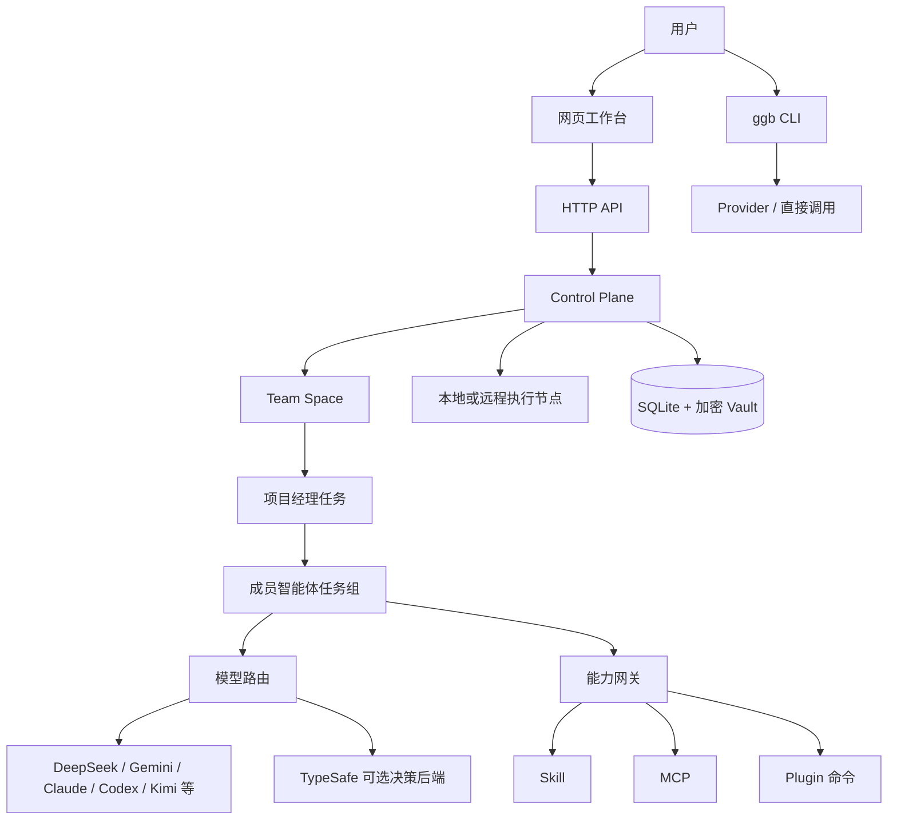

# Goal-Guided Brain

Goal-Guided Brain（简称 **GGB**）是一个面向个人的多团队 AI 协作工作台：用户把目标交给项目经理，项目经理负责澄清需求、组建智能体团队、选择模型和能力，并跟踪任务直到交付证据返回团队空间。

项目的核心判断是：模型会变化，个人的工作习惯、项目上下文、团队职责、权限边界和验收方式应该稳定。因此 GGB 把模型当作可替换的执行引擎，把团队、任务、能力和证据作为产品内核。

> 本文是项目总览、使用手册和当前架构说明。它描述仓库当前已经实现的行为，也明确列出尚未完成的边界，避免把规划误认为已经交付。

## 目录

- [产品目标](#产品目标)
- [核心概念](#核心概念)
- [整体架构](#整体架构)
- [从需求到交付](#从需求到交付)
- [团队招募](#团队招募)
- [智能体和模型](#智能体和模型)
- [Skill、MCP 和 Plugin](#skillmcp-和-plugin)
- [CLI](#cli)
- [网页工作台](#网页工作台)
- [数据和权限](#数据和权限)
- [接口和集成](#接口和集成)
- [部署和跨平台](#部署和跨平台)
- [开发、测试和发布](#开发测试和发布)
- [当前边界](#当前边界)
- [迭代路线](#迭代路线)

## 产品目标

GGB 主要解决四类问题：

1. 用户只描述目标，不需要先判断应该找产品、开发、运维还是资料助手。
2. 一个团队可以包含多个有明确职责的智能体，每个成员可以使用不同的模型和工具。
3. 团队可以持续讨论、拆解、执行、复核和汇总；团队之间也可以通过项目经理协作。
4. 所有重要动作都留下任务、消息、检查点、产物和验证证据，便于恢复和追踪。

GGB 不把“模型回答得像人”作为唯一目标。一个合格的执行结果还必须说明做了什么、依据是什么、哪些事情没有完成，以及下一步需要谁决定。

### 设计原则

| 原则       | 具体含义                                                     |
| ---------- | ------------------------------------------------------------ |
| 目标优先   | 从用户想达成的结果开始，而不是从模型或工具开始。             |
| 团队优先   | 用户主要和项目经理沟通，成员由项目经理按职责调度。           |
| 模型可替换 | 供应商和模型是路由配置，不绑定某个角色的人格。               |
| 权限最小化 | 助手只能使用已经绑定并获准的 Skill、MCP、Plugin 和工具。     |
| 证据优先   | 任务状态、外部操作和交付物必须有可检查的记录。               |
| 人在回路   | 发布、部署、删除、发送和其他高风险动作仍需要明确授权或复核。 |
| 可恢复     | 任务通过新的执行实例和检查点恢复，不假装恢复已经失联的进程。 |

## 核心概念

| 概念         | 说明                                                                                 |
| ------------ | ------------------------------------------------------------------------------------ |
| 工作空间     | 本地项目、知识、团队和运行数据的边界。默认数据目录为 `~/.dsh-workbench/`。           |
| 团队空间     | 用户与项目经理协作的长期容器。每个团队有目标、职责、成员、预算、工作目录和自治设置。 |
| 角色智能体   | 具有稳定职责的助手模板，例如项目经理、开发、产品和运维。角色不是固定模型。           |
| 成员实例     | 某个角色在某个任务中的一次执行。实例有自己的任务 ID、权限、租约和运行快照。          |
| 任务         | 一次具体目标。任务可以由用户创建，也可以由父任务或跨团队委派创建。                   |
| 任务组       | 一个主任务及其子任务、预算、依赖、消息和产物的集合。                                 |
| 执行尝试     | 任务的一次实际运行。失败重试会创建新的实例，避免覆盖旧结果。                         |
| 供应商       | 模型接口配置，包括协议、基础地址、凭据引用、模型列表和优先级。                       |
| Skill        | 注入给智能体的工作规范和知识文件。                                                   |
| MCP          | 通过受控协议暴露工具的服务。工具调用仍受实例权限和参数审批约束。                     |
| Plugin       | 可安装、固定版本并绑定到助手的能力包，可能包含 Skill、MCP、命令和助手模板。          |
| Team Charter | 项目经理在招募阶段生成的团队方案，包含成员、职责、交付物、模型和能力建议。           |
| 检查点       | 任务的目标、约束、决定、产物、操作和后续步骤，供新实例继续工作。                     |

## 整体架构



仓库中的主要实现位置如下：

| 模块       | 文件                                                         | 责任                                                                                                        |
| ---------- | ------------------------------------------------------------ | ----------------------------------------------------------------------------------------------------------- |
| HTTP 入口  | `server/index.mjs`                                           | 认证、请求解析、团队接口、状态接口和 MCP 入口。                                                             |
| 控制平面   | `server/platform.mjs`、`server/control.mjs`                  | 创建任务、调度、租约、预算、消息和团队协作。                                                                |
| 模型供应商 | `server/providers.mjs`                                       | 保存供应商、凭据引用、能力路由、探测和 TypeSafe 决策请求。                                                  |
| 原生运行时 | `server/runtime.mjs`                                         | 为任务生成隔离运行环境，注入模型、Skill 和能力配置。                                                        |
| 编排 MCP   | `server/orchestration-mcp.mjs`                               | 向运行中的智能体提供任务、团队、消息、能力和检查点工具。                                                    |
| 能力服务   | `server/capabilities.mjs`、`server/capability-gateway.mjs`   | 安装、固定、探测和授权 Skill、MCP、Plugin。                                                                 |
| 数据层     | `server/store.mjs`、`server/records.mjs`、`server/vault.mjs` | 业务实体、记录、迁移、备份和加密凭据。                                                                      |
| 网页       | `app/page.tsx`、`app/management.tsx`                         | 团队招募、团队动态、任务、助手、模型和能力管理。                                                            |
| CLI        | `scripts/cli.mjs`                                            | `ggb run`、`ggb chat`、`ggb rpc`、`ggb events`、`ggb providers`、`ggb doctor`、`ggb decide` 和 `ggb node`。 |

## 从需求到交付

一次典型工作流如下：

```text
用户描述目标
  → 团队空间保存消息
  → 项目经理读取团队上下文和个人偏好
  → 项目经理多轮澄清目标、约束、交付物和验收标准
  → 生成 Team Charter
  → 用户确认创建团队
  → 项目经理按职责分派子任务
  → 成员使用授权模型、Skill、MCP 和 Plugin 执行
  → 消息、检查点、任务板和产物持续回写
  → 项目经理复核结果和证据
  → 团队空间向用户汇总结果、风险和下一步
```

项目经理不能因为模型的一句话就把成员说成已经创建，也不能把计划当作完成结果。只有 Team Charter 确认、任务状态变化和实际产物记录才能改变对应状态。

任务完成与任务验收是两个状态。任务详情接口会返回执行目录、运行快照、事件、模型用量、产物、当前需求版本和最近验证记录；团队动态会在任务行显示交付状态和证据数量；管理界面可以查看差异、保存内部 Git 提交、运行一次明确的验证命令，并由所有者通过交付或退回复核。验证命令的输出会写成 `verification` 产物，需求变更会让旧版本证据和验收决定失效，项目经理和其他团队可以通过协作接口读取当前交付状态。提交或验证不会绕过正在运行、已隔离或状态未知的执行实例。

已确认团队的动态页还维护一份独立的目标与里程碑计划。目标更新会同步团队目标，里程碑可以记录说明、负责人、任务关联和完成状态；页面支持搜索并关联本团队最多 40 项任务、展示独立的执行/交付状态与验收计数，并直接打开执行记录进行验收。阶段进度可由用户标记或项目经理按证据维护，不会修改任务或自动生成验收；计划还可以设置截止日期、稳健/平衡/进取风险偏好和预算上限，预算不能超过团队自治预算。保存使用记录 `revision` 做乐观并发校验，避免多个设备用旧计划覆盖新进度。归档团队仍可读取历史计划，但不能继续修改。保存失败会保留当前输入和关联选择；多设备版本冲突可重新加载、核对后再保存，不能静默覆盖远端更新。

运行中的团队成员可用 `read_team_plan` 读取当前团队的计划、里程碑证据摘要、分页任务候选和最近 10 次智能体更新。仅项目经理可用 `upsert_team_milestone` 按最新 `expectedRevision` 创建/更新阶段，并提供原因；不能修改目标、预算和权限，暂停的计划不能写入。智能体标记完成时必须有关联任务，且每项均已通过当前需求版本的所有者验收。更新和审计在同一事务中保存，页面显示最近原因；`/api/state` 的 `spaces[].planRevision` 用于提示新版本，不静默覆盖当前编辑。执行上下文注入最多 10 个里程碑摘要，写入前仍须读取实时计划。

### 四种工作模式

这四种模式描述行为，不是四个固定机器人：

- **咨询**：分析和回答，不修改文件。
- **计划**：整理目标、约束、步骤和验收标准。
- **执行**：在授权范围内读写文件、运行测试和调用工具。
- **复核**：检查差异、测试、产物和证据，默认不扩大修改范围。

同一团队可以先计划，再执行，最后由独立成员或项目经理复核。

## 团队招募

### 招募阶段

团队招募使用三个阶段：

| 阶段        | 行为                                | 是否可以分派成员任务 |
| ----------- | ----------------------------------- | -------------------- |
| `discovery` | 项目经理与用户多轮澄清需求。        | 不可以。             |
| `proposed`  | 已保存 Team Charter，等待用户检查。 | 不可以。             |
| `confirmed` | 用户确认方案，成员被配置到团队。    | 可以。               |

### Team Charter 应包含

- 团队名称、目标和长期职责。
- 建议成员数量和每个成员的角色。
- 每个成员的职责、交付物和依赖。
- 每个成员需要的 Skill、MCP、Plugin 和工具权限。
- 候选供应商、模型和纯文本/工具调用要求。
- 未解决的问题和需要用户确认的风险。

确认前，`propose_team` 只保存草案；确认动作由用户在团队界面执行。确认时系统会再次验证成员、能力、供应商、模型和工具兼容性，避免招募过程中配置发生变化导致错误启动。

### 团队模板与复制

已确认的团队可以保存为模板，用于快速建立第二个开发、运维、产品或项目团队。模板只保存可复用配置：目标与职责、成员角色、成员模型/能力提示、团队模型、自治参数和默认执行目录模式。模板不会保存消息、招募会话、任务、草稿、附件或原团队的协作白名单。

用模板创建团队时，系统会生成新的团队 ID 和全新的招募元数据；界面要求重新确认名称、目标、工作目录、模型和协作边界。复制默认进入已确认状态以便直接执行，也可以选择从 `discovery` 阶段重新招募；任何跨团队授权都必须在新团队创建后重新选择并验证目标团队。

同一团队的项目经理消息按轮次串行处理。上一条请求处于 `queued` 或 `running` 时，新请求会返回 `409` 并把消息记录为 `blocked`，避免两个项目经理实例同时拆解同一份需求；团队对话会显示阻塞原因，上一轮完成后可以用相同消息 ID重新发送并继续同一个会话。

### 团队之间协作

团队通过项目经理交接目标，而不是直接共享私有消息。源团队需要允许目标团队，目标团队必须处于活动和已确认状态。目标团队会收到独立任务组，可以使用自己的模型、预算、工作目录和能力配置。

团队协作配置包含 `collaboration.enabled` 和可选的 `allowedTeamIds`。开启协作且白名单为空时，表示允许发现当前及之后新建的活动团队；关闭时不会返回协作者，也不能发起协作请求。填写白名单可以把协作范围限制在指定团队。团队动态页的跨团队协作控制台会读取同一份授权结果，用户可以选择目标团队并提交协作目标；委派消息、目标任务和完成/失败回传会在源团队和目标团队的最近协作记录中显示。

每次跨团队委派都会在目标团队写入一条 `handoff` 消息，同时在发起团队保留关联记录。两边都通过 `taskId` 关联同一个目标任务，团队动态可以显示目标任务当前状态，避免请求发出后失去追踪。

运行中的智能体可以通过编排 MCP 使用：

- `list_teams`：查看当前允许协作的团队摘要。
- `delegate_to_team`：向目标团队项目经理委派目标。
- `list_team_collaborations`：按方向和状态分页查看当前团队自己的协作记录、回传摘要和收尾状态。
- `read_team_task`：只读取当前团队实际委派且仍获准任务的状态、结果、共享回传及收尾状态；排除目标团队其他工作和内部消息。

### 草稿和招募会话同步

招募输入和团队对话使用服务端记录作为跨设备事实来源，页面通过 `after` 游标增量拉取其他设备新增的消息。未发送的输入草稿按“空间 + 角色”保存，服务端返回递增 `revision` 和更新时间；浏览器同时保存本机缓存，服务不可用时仍可继续编辑并在恢复后重试。

草稿同步采用基础版本进行三方合并：本机和远端只修改不同文本区间时自动合并，附件按稳定 ID 去重合并；同一区间出现不同内容时保留冲突，不会静默覆盖任何一方。界面会显示本机与远端版本，用户选择“保留本机并覆盖远端”或“使用远端版本”后才清除冲突并继续同步。切换团队或角色会清除当前编辑态，但不会把另一团队的草稿或附件带入新空间。

## 智能体和模型

### 角色与模型分离

角色描述“负责什么”，模型描述“如何执行”。例如：

- 项目经理可使用长上下文、规划能力稳定的模型。
- 开发成员可使用工具调用和代码能力稳定的模型。
- 运维成员可使用低延迟模型处理监控，再用更强模型复核异常。
- 复核成员可以使用不同供应商，减少单一模型判断错误的影响。

用户可以在团队、角色或单次任务上指定模型；未指定时使用候选供应商和优先级路由。

### 当前普通模型协议

- DeepSeek 协议。
- OpenAI Chat Completions。
- OpenAI Responses。
- Anthropic Messages。

路由会检查供应商是否启用、凭据是否存在、模型是否满足工具、视觉和上下文长度要求。网络错误或认证失败可以按候选顺序切换，但已经产生工具副作用的任务不会被整个自动重跑。

### TypeSafe 的可选位置

[TypeSafe System One](https://docs.typesafe.ai/introduction) 是结构化判断接口，不是聊天或代码生成模型。GGB 将它作为独立的可选决策后端：输入 `state` 和带类型的问题，返回 `choice`、`score`、`noul`、概率和置信度。

它可以用于：

- 团队招募中的任务类型和角色需求预评估。
- 任务复杂度、风险和是否需要人工复核的判断。
- 多团队路由前的结构化分类。

它不会替代 DeepSeek、Gemini、Claude、Codex 或 Kimi 的聊天和代码执行。未配置 TypeSafe 时，团队招募和普通任务继续使用当前模型。低置信度和高风险动作仍需要项目经理或用户确认；置信度不是事实证明。

网页配置建议：基础地址 `https://api.typesafe.ai/v1`，模型 `jev-latest`，凭据通过加密凭据库保存。CLI 使用 `TYPESAFE_API_KEY` 和 `ggb decide`。智能体在 TypeSafe 已配置时可通过 MCP 的 `evaluate_decision` 调用它。

## Skill、MCP 和 Plugin

### 能力生命周期

```text
检索来源
  → 查看兼容性和权限
  → 安装指定版本
  → 计算并保存摘要
  → 启用并绑定到角色/团队
  → 启动任务时固定运行快照
  → 探测健康状态
  → 升级、回退或禁用
```

能力中心支持 Skills、MCP Registry、Plugin 和可转换的第三方助手/命令来源。安装成功不代表原平台的所有行为都兼容；界面会展示支持和不支持的部分。

### 运行时边界

- Skill 以固定版本文件注入运行环境。
- MCP 工具通过能力网关连接，按工具名和参数进行授权。
- Plugin 命令通过受控子任务排队，不直接获得父任务之外的权限。
- 智能体可以使用 `list_capabilities` 查看本次执行实际绑定的能力。
- 未绑定、已禁用或版本摘要不匹配的能力不会注入运行时。
- 外部 MCP 的 `readOnlyHint` 只是服务方声明，不是独立的安全证明。

## CLI

需要 Node.js 22.13+。安装依赖后可以使用本地命令，也可以通过 npm 全局链接：

```bash
npm install
npm link
```

品牌命令是 `ggb`，兼容别名是 `dsh`、`dsh-workbench` 和 `goal-guided-brain`。Windows、macOS 和 Linux 都由 npm 生成对应命令入口，不要求 WSL 才能使用 CLI。

### 普通执行

```bash
export DEEPSEEK_API_KEY=...
ggb run --provider deepseek --model deepseek-chat "分析当前项目的风险"
echo "设计一个缓存方案" | ggb run --provider claude
ggb run --provider gemini --no-stream --json "总结这段代码"
printf '{"type":"prompt","id":"p1","text":"检查项目"}\n' | ggb rpc --provider deepseek --session automation
ggb events <task-id> --once --json
ggb doctor --json
ggb node --control-url https://workbench.example.com --workspace project=/absolute/path --print-config
```

### 持续对话

```bash
ggb chat --provider claude --session personal
```

交互中支持 `/new`、`/model [供应商/]模型`、`/session`、`/help` 和 `/exit`。会话以 JSONL 保存，`--continue` 可以恢复最近会话；密钥不会写入会话文件。`ggb rpc` 使用 stdin/stdout JSONL，支持 `prompt`、`follow_up`、`set_model`、`abort`、`session` 和 `ping`，输出 `turn_start`、`text_delta`、`turn_end`、`model_changed`、`aborted` 和 `error` 等稳定事件，适合 IDE、脚本和其他客户端接入。`ggb events <task-id>` 订阅工作台任务 SSE，`ggb events --team <team-id>` 订阅团队消息、委派和执行 SSE；两者都支持 `--after` 用于断线恢复，`--once --json` 适合脚本读取历史事件。

### 结构化决策

```bash
export TYPESAFE_API_KEY=...
ggb decide \
  --state '{"goal":"发布版本","constraints":["周五前完成"]}' \
  --questions '{"urgent":{"type":"noul","instructions":"Is this urgent?"}}' \
  --json
```

`ggb decide` 只返回结构化 JSON，不会生成聊天回复。TypeSafe 密钥是可选配置，不设置时不影响 `ggb run` 和 `ggb chat`。

`ggb doctor` 是跨平台自检命令：它验证 Node.js 版本、运行平台、会话目录写权限、Git、已配置的模型凭据，以及可选的本地 API 和网页地址。传入 `--node-config` 时还会验证控制端地址、节点数据目录和工作目录映射是否可用。API 或网页没有启动时报告为提醒，不会阻止 CLI 直接访问模型；`--strict` 会把警告也纳入失败门禁并设置非零退出码，`--json` 输出包含 `strictOk` 的稳定报告，不包含任何凭据值、节点 token 或身份文件内容。

`ggb node` 是远程执行节点的统一入口，会把参数转发给节点 worker。它支持重复的 `--workspace 名称=本机绝对路径`、`--pair`、`--name`、`--data-dir` 和 `--max-concurrent`；`--print-config` 用于生成可保存的安全配置，绝不会读取或打印节点身份和 token。Linux、macOS、Windows 与 WSL2 使用同一条命令。

### 供应商环境变量

| 供应商       | 默认密钥变量                          |
| ------------ | ------------------------------------- |
| DeepSeek     | `DEEPSEEK_API_KEY`                    |
| Kimi         | `KIMI_API_KEY` 或 `MOONSHOT_API_KEY`  |
| Gemini       | `GEMINI_API_KEY` 或 `GOOGLE_API_KEY`  |
| Claude       | `ANTHROPIC_API_KEY`                   |
| Codex/OpenAI | `CODEX_API_KEY` 或 `OPENAI_API_KEY`   |
| TypeSafe     | `TYPESAFE_API_KEY`（只用于 `decide`） |

也可以通过 `--api-key` 临时传入；临时密钥不会自动写入磁盘。

## 网页工作台

网页主入口是“团队招募”，侧边栏按团队显示长期团队，不再要求用户先选择一个固定助手。主要区域包括：

- **团队招募**：和项目经理多轮澄清，查看 Team Charter 并确认创建。招募页会固定显示当前对象是“需求草稿”、所处阶段和下一步；确认前不会把它放进“我的团队”。
- **团队动态**：查看成员状态、任务、消息和结果。
- **助手与模型**：管理角色、职责、候选供应商、模型和工具要求。
- **后台任务**：查看任务组、执行记录、检查点、产物和失败原因。
- **能力中心**：安装和管理 Skill、MCP、Plugin。
- **知识库**：管理个人、项目、团队和角色范围的知识；团队规则只注入当前团队的任务，有复核截止日期的团队知识会在风险收件箱中提示并直达编辑。
- **模型管理**：管理加密凭据、供应商、模型和连通性测试，并按团队、助手、供应商和模型查看真实运行指标。
- **团队高级配置**：设置团队类型、项目经理、成员、工作目录、协作开关、自治模式以及拆解层级、活跃任务和 Token 预算限额；团队页显示累计用量、剩余量和预警状态。

首次初始化只建立一个 `discovery` 需求草稿，成员只有项目经理，确认时间为空；不能提前派发开发成员任务。重启不会重复创建草稿，也不会把已有已确认团队改回招募。页面根据真实招募阶段修正旧的会话入口缓存，已归档空间不会成为默认会话；管理页的视图恢复保持独立。需求/团队选择器显示可读名称，内部 ID 仅用于绑定。

首次使用建议顺序：

1. 打开模型管理，初始化凭据库并保存至少一个普通聊天模型。
2. 确认项目工作目录和执行引擎可用。
3. 返回团队招募，描述目标，不要先手动决定成员数量。
4. 多轮澄清完成后检查 Team Charter。
5. 点击确认创建团队，再让项目经理开始拆解任务。

## 数据和权限

### 数据目录

| 内容     | 默认位置                            | 说明                                   |
| -------- | ----------------------------------- | -------------------------------------- |
| SQLite   | `~/.dsh-workbench/workspace.sqlite` | 团队、任务、消息、知识、调度和配置。   |
| 加密凭据 | `~/.dsh-workbench/vault.json`       | Argon2id 派生密钥和 AES-256-GCM 加密。 |
| 执行目录 | `~/.dsh-workbench/runs/<taskId>/`   | 隔离的运行环境、日志和临时文件。       |
| 能力包   | `~/.dsh-workbench/capabilities/`    | 固定版本和摘要后的 Skill/Plugin 内容。 |
| 备份     | `~/.dsh-workbench/backups/`         | SQLite 一致性备份及凭据副本。          |

可使用 `WORKBENCH_DATA_DIR` 指定数据目录。一个数据目录只允许一个控制平面持有写入锁。

### 权限规则

- 任务实例凭证由系统签发并可撤销，不使用用户 API Key 作为实例身份。
- 实例只能访问自己的任务组、被绑定的能力和被授权的外部操作。
- 团队消息不会自动授予新权限。
- 任务暂停、取消、预算超限或租约过期时，执行权限会被撤销。
- 外部操作使用幂等键；已执行但结果未知的操作不会自动重试。
- 模型、Skill、MCP 和 Plugin 的实际配置会写入运行快照，避免任务中途静默改变行为。
- 日志、消息、产物和错误必须过滤凭据、节点令牌和 Authorization 头。

### 高风险动作

读取、分析和本地验证可以在授权范围内连续完成。发送消息、发布、部署、删除、支付或修改生产系统等动作必须经过明确授权、操作登记和结果记录；模型建议、TypeSafe 置信度和 MCP 的只读声明都不能代替授权。

## 接口和集成

### HTTP API

API 默认监听 `127.0.0.1:3089`，网页默认监听 `127.0.0.1:3088`。除健康检查外需要登录。

| 方法                  | 路径                                 | 用途                                                                                                                                                                                                                                                                                                                                                                                                                                      |
| --------------------- | ------------------------------------ | ----------------------------------------------------------------------------------------------------------------------------------------------------------------------------------------------------------------------------------------------------------------------------------------------------------------------------------------------------------------------------------------------------------------------------------------- |
| `GET`                 | `/api/health`                        | 健康检查，支持 `HEAD`。                                                                                                                                                                                                                                                                                                                                                                                                                   |
| `GET`                 | `/api/state`                         | 返回角色、团队、供应商、任务、能力和配置摘要。                                                                                                                                                                                                                                                                                                                                                                                            |
| `GET/POST`            | `/api/teams`                         | 列出或创建团队；`/api/spaces` 是兼容别名。                                                                                                                                                                                                                                                                                                                                                                                                |
| `GET/PUT`             | `/api/teams/:id`                     | 查看或更新团队配置、消息和任务；团队归档/恢复必须使用下面的生命周期接口。                                                                                                                                                                                                                                                                                                                                                                 |
| `POST`                | `/api/teams/:id/archive`             | 归档已确认团队；保留历史、任务和交付证据，有进行中任务时返回 `409`。`/api/spaces` 和 `/api/chats` 是兼容别名。                                                                                                                                                                                                                                                                                                                            |
| `POST`                | `/api/teams/:id/restore`             | 恢复已归档团队为活动状态，清除归档时间并回到“我的团队”。                                                                                                                                                                                                                                                                                                                                                                                  |
| `GET/POST`            | `/api/team-templates`                | 列出或保存已确认团队的可复用配置模板；模板不包含历史、任务、招募会话或附件。                                                                                                                                                                                                                                                                                                                                                              |
| `GET/PUT/DELETE`      | `/api/team-templates/:id`            | 查看、更新或删除团队模板。                                                                                                                                                                                                                                                                                                                                                                                                                |
| `POST`                | `/api/team-templates/:id/apply`      | 用模板创建全新团队，并重新确认名称、目标、工作区和协作边界。                                                                                                                                                                                                                                                                                                                                                                              |
| `GET`                 | `/api/teams/:id/timeline`            | 按 `kind=all/messages/execution/evidence/risk/collaboration` 先筛选，再用 `limit` 和 `before=时间\|记录ID` 游标分页；返回 `items` 和 `hasMore`。                                                                                                                                                                                                                                                                                          |
| `GET`                 | `/api/teams/:id/events`              | 按 `after=时间\|记录ID` 增量读取团队消息、任务和执行事件；新连接默认回放最近窗口。`/api/spaces` 和 `/api/chats` 是兼容别名。                                                                                                                                                                                                                                                                                                              |
| `GET`                 | `/api/teams/:id/events/stream`       | 以 SSE 推送团队消息、消息状态回写、任务执行事件、产物/验收变化和风险刷新标记；先回放当前窗口，再推送后续事件，支持 `after` 游标断线恢复；CLI 可用 `ggb events --team` 订阅。                                                                                                                                                                                                                                                              |
| `GET`                 | `/api/teams/:id/recruitment`         | 按 `after=时间\|记录ID` 增量读取招募会话消息，支持多设备继续同一会话。                                                                                                                                                                                                                                                                                                                                                                    |
| `GET`                 | `/api/drafts`                        | 按 `spaceId`、`role` 查询参数读取服务端草稿、附件引用、版本和更新时间。                                                                                                                                                                                                                                                                                                                                                                   |
| `PUT`                 | `/api/drafts`                        | 按请求体中的 `spaceId`、`roleId` 写入草稿；带上当前 `revision` 做乐观并发校验，版本过期返回 `409` 和远端草稿供三方合并。                                                                                                                                                                                                                                                                                                                  |
| `DELETE`              | `/api/drafts`                        | 清理已发送或用户主动放弃的草稿及其附件引用。                                                                                                                                                                                                                                                                                                                                                                                              |
| `GET`                 | `/api/timeline`                      | 聚合已确认团队的统一时间线；支持 `teamId`、`kind=all/messages/execution/evidence/risk`、`limit` 和 `before`。                                                                                                                                                                                                                                                                                                                             |
| `GET`                 | `/api/risks`                         | 聚合已确认团队的执行、交付、待确认和知识复核风险；支持 `teamId`、`kind`、`status`、`limit` 和 `before` 筛选。知识风险返回 `knowledgeId`，可直接打开知识编辑。                                                                                                                                                                                                                                                                             |
| `POST`                | `/api/teams/:id/messages`            | 向团队项目经理发送用户需求。                                                                                                                                                                                                                                                                                                                                                                                                              |
| `POST`                | `/api/teams/:id/recruitment/confirm` | 用户确认 Team Charter。                                                                                                                                                                                                                                                                                                                                                                                                                   |
| `GET`                 | `/api/teams/:id/collaborators`       | 查看允许协作的团队。                                                                                                                                                                                                                                                                                                                                                                                                                      |
| `POST`                | `/api/teams/:id/collaborate`         | 向其他团队项目经理委派协作目标。                                                                                                                                                                                                                                                                                                                                                                                                          |
| `GET/POST/PUT/DELETE` | `/api/providers`                     | 管理供应商；`POST /api/providers/:id/probe` 做连通性测试。                                                                                                                                                                                                                                                                                                                                                                                |
| `GET/POST/PUT/DELETE` | `/api/credentials`                   | 管理加密凭据库中的引用。                                                                                                                                                                                                                                                                                                                                                                                                                  |
| `GET/POST/PUT/DELETE` | `/api/capabilities`                  | 管理能力包和能力版本。                                                                                                                                                                                                                                                                                                                                                                                                                    |
| `POST/PUT`            | `/api/roles`                         | 创建或更新角色智能体；角色列表随 `/api/state` 和 `/api/manage` 返回。                                                                                                                                                                                                                                                                                                                                                                     |
| `GET/POST/PUT`        | `/api/knowledge`                     | 管理知识和历史版本；`scope=team` 时必须提供有效 `teamId`。                                                                                                                                                                                                                                                                                                                                                                                |
| `GET`                 | `/api/knowledge/:id`                 | 读取单条知识的当前版本和复核状态，供风险收件箱直达编辑使用。                                                                                                                                                                                                                                                                                                                                                                              |
| `GET` / `PUT`         | `/api/teams/:id/plan`                | 读取或更新团队目标与里程碑计划；PUT 使用记录 revision 做乐观并发校验，计划目标会同步团队身份；milestones[].taskIds 去重且最多 40 项，必须指向本团队存在的执行任务，无效关联拒绝整次更新。                                                                                                                                                                                                                                                 |
| `POST`                | `/api/tasks`                         | 创建任务；任务控制接口还支持取消和重试。                                                                                                                                                                                                                                                                                                                                                                                                  |
| `GET`                 | `/api/tasks/:id`                     | 查看任务、执行目录、运行快照、事件、用量、产物和最近验证。                                                                                                                                                                                                                                                                                                                                                                                |
| `GET`                 | `/api/tasks/:id/events`              | 按 `after=时间                                                                                                                                                                                                                                                                                                                                                                                                                            | 事件ID`和`limit` 增量读取任务事件，返回 oldest-first 页面、`hasMore` 和下一次游标。 |
| `GET`                 | `/api/tasks/:id/events/stream`       | 以 SSE 推送任务事件；支持相同的 `after` 游标，先补发历史事件，再推送后续事件，断线可回到游标接口恢复。                                                                                                                                                                                                                                                                                                                                    |
| `POST`                | `/api/jobs/:id/archive`              | 归档或恢复已结束且状态明确的任务组；归档只隐藏历史记录，不删除任务、产物或验收证据。                                                                                                                                                                                                                                                                                                                                                      |
| `POST`                | `/api/tasks/batch-review`            | 所有者批量通过或退回复核已完成任务；最多 50 项，整批预校验，退回需要统一备注。                                                                                                                                                                                                                                                                                                                                                            |
| `GET`                 | `/api/workspaces/:taskId`            | 查看任务执行目录的未提交差异。                                                                                                                                                                                                                                                                                                                                                                                                            |
| `POST`                | `/api/workspaces/:taskId/commit`     | 保存工作树的内部提交，结果等待复核。                                                                                                                                                                                                                                                                                                                                                                                                      |
| `POST`                | `/api/workspaces/:taskId/verify`     | 在空闲执行目录中运行验证命令并保存验证产物。                                                                                                                                                                                                                                                                                                                                                                                              |
| `GET`                 | `/api/manage`                        | 返回管理界面所需的聚合数据。                                                                                                                                                                                                                                                                                                                                                                                                              |
| `GET`                 | `/api/metrics/models`                | 返回模型运行指标、验收证据质量摘要和 `taskTypeComparisons`；支持 `since`、`until`、`taskType`、`teamId`、`roleId`、`providerId` 和 `model` 筛选，并返回当前窗口证据覆盖率、过期/失败/待补证据、按团队/任务类型覆盖率、按任务类型的最终状态/失败尝试/延迟/Token/费用对比和按 UTC 日期聚合的趋势。网页预置全部时间、最近 7 天和最近 30 天三个窗口，任务类型由任务元数据持久化并向旧任务提供可解释回退，查询也接受 `dev`、`ops` 等稳定别名。 |
| `POST`                | `/api/attention/:id/resolve`         | 所有者处理普通事项时提交 1–4000 字符的 `resolution`，同时持久化处理记录并将关联通知标为已读；重复提交不改写首次决定，未知事项返回 404，事务失败回滚。工具审批继续使用独立的批准/拒绝分支，普通处理不会重试任务或更改交付验收。                                                                                                                                                                                                            |
| `POST`                | `/api/mcp`                           | 运行实例使用的编排 MCP。                                                                                                                                                                                                                                                                                                                                                                                                                  |
| `POST`                | `/api/capability-mcp/:id`            | 绑定能力的 MCP 工具网关。                                                                                                                                                                                                                                                                                                                                                                                                                 |

请求体使用 JSON。远程公开部署必须通过 HTTPS、登录认证和反向代理；不要直接把 3088/3089 暴露到公网。

### 编排 MCP 工具

运行中的智能体可以发现并使用以下类别的工具：

- 能力：`list_capabilities`、`list_capability_catalog`、`run_capability_command`。
- 团队：`list_teams`、`list_team_collaborations`、`delegate_to_team`、`read_team_task`、`read_team_roster`、`propose_team`。
- 计划：`read_team_plan`、`upsert_team_milestone`。
- 任务：`list_agents`、`delegate_task`、`save_checkpoint`、`submit_artifact`。
- 通信：`read_inbox`、`ack_message`、`send_message`。
- 任务板和关注事项：`read_board`、`update_board`、`request_attention`。
- 外部操作：`begin_operation`、`complete_operation`。
- 可选决策：`evaluate_decision`，只调用已配置的 TypeSafe，不直接执行动作。

### 可调用方式

GGB 目前提供网页、CLI、HTTP API 和 MCP 四个入口。网页、HTTP API 和 MCP 共享服务端 SQLite、凭据库、模型配置和控制平面；CLI 的 `run/chat` 直接调用供应商并用本地 JSONL 保存会话，`decide` 直接调用 TypeSafe，`node` 作为跨平台 worker 接入控制平面。

## 部署和跨平台

### 本地开发

```bash
npm install
npm run dev
```

开发模式启动 API `3089` 和网页 `3088`。生产模式：

```bash
npm run build
npm start
```

### 控制平面和执行节点

控制平面负责数据库、调度、模型请求和 MCP 网关；执行节点负责实际工作目录中的 DSH 运行。节点通过出站 HTTPS 配对，使用租约、心跳和一次性报告避免重复执行。

- macOS：可以运行本地控制平面和执行节点。
- Linux：适合常驻控制平面和远程执行节点，仓库提供 systemd 模板。
- Windows：CLI 和执行节点兼容原生 Windows（`.cmd` DSH shim、`taskkill.exe` 进程树终止及跨系统能力包路径映射均有确定性 fixture）；WSL2 仍是推荐部署方式，因为 Git、shell 工具和第三方能力更容易保持一致。原生 Windows/WSL2 真实现场验收仍是发布门槛。
- 控制平面当前连接外部 stdio MCP，节点本地 stdio MCP 尚未实现。

完整部署步骤见 [deploy/README.md](../deploy/README.md)，备份和恢复见 [deploy/backup-restore.md](../deploy/backup-restore.md)。

## 开发、测试和发布

### 常用命令

```bash
npm run lint
npm run typecheck
npm test
npm run build
```

测试使用临时数据库、本地确定性模型和 MCP fixture，不调用付费模型。覆盖加密凭据、协议认证、模型路由、模型运行指标与验收证据质量摘要及按日趋势、任务类型持久化/父子继承/任务类型筛选、知识版本与过期过滤、团队知识复核风险与直达编辑、通知管理页聚合风险和单条知识读取、团队目标与里程碑计划、计划逾期通知去重与改期收敛、能力绑定可见性、能力风险摘要、能力启用确认与审计、Team Charter 能力绑定确认与审计、工具网关、任务租约、消息幂等、团队招募、团队模板复制、多设备招募会话游标、服务端草稿版本、多设备草稿自动合并与冲突选择、跨团队协作白名单、团队自治暂停/恢复、团队自治限额、团队归档/恢复和进行中任务拦截、团队专属知识隔离、工作树、定时任务、定时任务失败通知、任务介入事项持久通知与已读状态、恢复、任务组归档/恢复、任务中心按团队/状态筛选、CLI 节点 bootstrap、`ggb node` 统一入口、`ggb rpc` JSONL 事件流与中止、`ggb events` 任务和团队 SSE 订阅、`ggb doctor --strict` 部署门禁、节点配置校验、批量复核失败提示、任务事件游标、任务与团队 SSE 实时流、网页增量消费和断线回放、远程节点在线/执行状态、失联提醒、恢复和断线恢复事件；当前后端套件为 240/240，最近一次桌面/移动浏览器全量验证为 226 个运行，并包含手机端团队上下文、支持按名称/职责搜索的快速切换团队、底部主导航、导航抽屉、触控文件入口、底部设置面板、模型指标卡片无横向溢出、团队实时消息回归、对话上滑阅读与回到最新、执行节点配对向导、节点详情状态刷新、失联提醒与恢复和撤销后重新配对回归。

状态接口为每次同步读取建立短生命周期索引，将任务、产物、验收、团队消息与用量按身份聚合，共享集合在一次响应中只读取一次。索引不跨请求保留；下一次刷新会读取其他 SQLite 连接提交的更新和删除。完整任务结果、消息和既有时间线分页仍然保留。隔离性能基准使用 `node tests/benchmark-state.mjs 10 20`（10 个团队，每队 20 个任务）；长期增长后的完整响应体积和浏览器渲染仍需继续优化。

状态响应携带当前公开 JSON 的 ETag。后台轮询使用条件请求，未变化时返回无正文的 304；浏览器复用本次会话内对应的状态对象，并校正期间收到的增量招募更新。代理透传校验头，接口先验证登录，保留 `no-store`；首次加载、手动重试及操作后的主动刷新仍读取当前视图的完整内容。外部 SQLite 写入、删除及知识到期会产生新版本，迟到请求不能替换当前内容或校验标记。条件请求仍需服务端计算当前视图状态。浏览器拥有匹配基线时，额外发送 `X-GGB-State-Delta: 1`；服务端仅在增量正文更小时以 `X-GGB-State-Format: delta-v1` 返回记录变更、删除及顺序，客户端不可变合并为完整状态。未选择增量的客户端保持原协议。差异基线按工作台实例隔离，最多保留 8 个快照、合计 8 MiB 序列化正文，60 秒过期；这不是进程堆内存上限，也不复用基线代替数据库读取。基线缺失、淘汰或服务重启后自动返回完整快照。版本不匹配、结构损坏或格式头缺失时保留旧内容，随后通过完整请求恢复。

网页状态请求携带 `X-GGB-State-View: workbench`，响应以 `teamActivityDeferred: true` 明确标记各团队的 `messages` 与 `timeline` 已延后读取，不以空数组伪装无动态。角色、团队元信息、完整任务正文及统计保持原样；默认 API 客户端仍收到原完整响应，`Vary` 包含该协商头。进入团队动态才请求当前团队的时间线：首批最多 120 条，向前每页 60 条，类型筛选在服务端分页前执行。切换团队/筛选立即隔离旧数据，迟到响应无法覆盖当前页面。首屏、刷新和分页失败提供对应提示与重试；分页失败保留已加载记录并重试原游标。页面挂载期间每 5 秒校验，并响应团队 SSE 刷新；重新读取已展开的历史窗口以同步旧记录修改和删除，离开页面后停止轮询。最近协作单独按 `kind=collaboration` 读取最新 8 条，避免普通消息挤掉较早的委派与回传；刷新后仍可读取，并有独立失败重试。未展开的时间线保持初始窗口，只有用户加载更早动态后才重读扩展窗口。失败任务优先显示错误摘要，已创建团队使用日常协作提示而非招募创建流程。

对话正文默认渲染最近 30 轮，可逐页展开全部历史；上滑阅读时固定当前窗口起点，新增任务不会挤掉正在看的内容。通过任务身份和视口内偏移保留阅读锚点，补载和上方回复变长时调整滚动位置；回到最新收起历史，成员会话切换创建独立阅读窗口。未变化的 Markdown 回复复用渲染结果。有历史内容时使用紧凑标题与输入提示，为桌面和手机保留正文空间。标题区提供当前对话搜索，匹配需求、回复和标题，显示匹配片段和时间；每次展示 20 个结果，可继续查看全部结果。选择结果会展开对应历史、定位并标记原文，键盘焦点回到消息本身，输入草稿保持不变；手机系统返回先关闭搜索并保留工作台。搜索严格使用当前团队/成员会话的对话集合，切换上下文会重置关键词与结果。渲染窗口和搜索使用浏览器保有的完整会话；后台刷新已支持状态差异传输，但首次加载、主动刷新和增量回退仍获取全部任务正文。服务端按会话分页与检索索引仍是后续工作。

首次数据读取由独立的刷新 Hook 管理。界面在读取成功前展示加载或错误恢复状态，避免点击操作时角色和团队尚未就绪；请求超过 15 秒会中止并提供重试。后台轮询不会重叠，主动刷新会替换进行中的旧请求，过期的成功或失败响应均被忽略。已有数据时连接失败保留当前内容，并显示新鲜度提示，不清空团队或草稿。

跨团队协作表单按来源团队在当前浏览器持久化目标、需求和验收标准；它与服务端同步的对话草稿分开，暂不提供跨设备表单同步。目标列表失败或超时可原地重试，不会自动换成另一目标团队。预览绑定当前输入，修改后必须重新审阅。确认后保存固定的 `clientMessageId`，请求超时、断连或回执缺少任务 ID 时保留原请求并锁定编辑，可刷新后通过“重试确认送达”继续；明确的 4xx 拒绝则保留草稿并允许修改。成功后仅清理仍对应同一请求 ID 的草稿，迟到回执不能清掉新的输入。

工作台跨团队派发接口 `POST /teams/:id/collaborate` 与智能体的 `delegate_to_team` 共用数据库保存点，将接收消息、任务、逻辑任务、任务元信息与来源团队记录一起提交；实时事件在成功提交后按最新记录合并发布，失败回滚不发布成功。已完成的历史任务不计入活跃任务限额；旧的无任务消息可以重新创建关联任务，若任务元信息已关联原消息则修复链接而不重复创建任务。记录关联冲突会拒绝重试，不会接管其他任务。

MCP 的消息标识包含来源任务 ID；不同任务可以使用相同幂等键而不覆盖彼此，旧格式记录仅在来源、目标和请求身份匹配时复用。每次新委派使用目标团队自己的独立会话、任务组、模型和工作目录；重试返回原任务。委派前继续校验团队招募状态、活动状态、协作白名单、自动协作配置和当前执行租约。

协作记录默认读取最近 8 条，支持展开完整消息和继续加载历史。来源团队可从已结束任务的原请求或回传记录发起“继续协作”；草稿保存原记录引用，目标团队随引用固定，取消引用后才可改成新的协作。已有输入需要先选择保留或替换，待确认送达期间不能改换引用。发送前审阅展示关联记录，服务端校验来源、目标、双方消息、任务元信息及原任务状态，从存储中读取原请求和回传内容作为后续任务上下文；不采信客户端提供的历史正文。

网页与 `delegate_to_team` 均接受可选 `followupMessageId`（来源团队原协作消息 ID）。仅允许从 completed、failed、cancelled、interrupted 的原任务继续；进行中或 state_unknown 必须先处理原任务。后续消息通过 `followupMessageId` 持久关联原请求，任务、会话和验收保持独立；重复请求不会生成另一任务。此功能不自动接受原交付。

来源团队可通过“处理协作”确认收尾。`GET/POST /teams/:id/collaboration-review/:messageId` 仅供工作台所有者操作来源团队的原请求；智能体凭据不能作所有者决定。`complete` 要求当前任务交付为 accepted，`end` 要求任务已结束并填写原因，`reopen` 要求填写重新打开原因。收尾不会修改原任务、验收决定或关联后续任务。关闭后网页和 MCP 均不能新建追问，重新打开不自动运行任务；此前已送达请求仍可重试取得原回执。

收尾决定与审计记录原子保存，提交后刷新来源及目标团队。保存同时校验记录 revision 和任务结果、错误、状态、当前需求及验收证据的指纹；旧页面不会覆盖新决定，外部结果变化即使未更新时间戳也会触发“需重新复核”。当前决定与最近 20 条处理历史可查看，全部审计保存在数据库。处理说明和待确认请求按原协作在本机保存；未知提交结果锁定内容并使用同一请求 ID 重试，明确拒绝保留说明并允许重新读取状态。协作链路的汇总关闭与处理草稿跨设备同步仍待完善。

智能体读取通过当前实例租约和已确认活动团队校验。`list_team_collaborations` 默认 direction=outgoing、status=all、limit=20，最多 50 条；方向支持 incoming/all，状态支持 open/closed/stale/unlinked。先筛选后分页，nextCursor 作为 before，游标绑定当前团队、方向及状态；改变筛选必须从第一页读取。相同时间戳按消息 ID 的稳定字符顺序排序，与游标比较一致。counts 汇总当前方向的各状态数量，total 是当前状态筛选后的数量。列表读取实时状态，不是冻结快照；处理前需重读。

列表只以当前团队自己的协作消息作为入口，未关联记录不给出可执行任务或追问权限。请求和已收到回传各截取最多 4000 字符并标明截断；权限关闭后仍可读取本团队已持有的历史内容，canReadTask/canFollowUp 会关闭，不能读取目标团队未共享的新正文。详细读取必须验证原请求、双方消息、任务元信息和来源团队，除结果外只返回原协作消息及匹配的共享回传。收尾投影标注 decisionAuthority=owner，ownerCanComplete/ownerCanEnd 不代表智能体权限；nextAction 提供等待、复核证据、请求所有者复核等提示，不自动执行操作。

### 每轮迭代要求

1. 先读取当前主分支和工作区状态。
2. 只完成一组可以被验证的相关改动。
3. 为用户可见行为补充或更新测试。
4. 运行与改动相关的测试，再运行完整测试、lint、typecheck 和 build。
5. 检查 `git diff --check` 和敏感信息泄漏。
6. 使用清晰的提交信息提交；默认只保留本地提交，只有用户明确要求时才推送到远程 `main`。
7. 在更新中说明提交、验证结果和仍然存在的边界。

### 版本和分支

当前仓库远程地址：

```text
https://github.com/lianjiexu08-ui/Goal-Guided-Brain.git
```

默认分支为 `main`。短期功能迭代使用独立提交；涉及较大实验时使用 `codex/` 前缀分支，合并前保留完整验证记录。

## 当前边界

以下内容已经明确记录为后续工作，不能在产品文案中伪装成已完成：

- 真实 Linux、Windows/WSL2 执行节点的现场验收尚未替代本机测试。
- 真实云端 HTTPS、节点配对和所有者离线时继续调度需要目标基础设施。
- 控制平面的外部 stdio MCP 尚未支持节点本地部署。
- MCP Resources/Prompts、LSP、平台专属界面和部分第三方 Hook 尚未完整兼容。
- TypeSafe 是可选的托管决策接口，不能作为普通聊天模型，也不能被视为事实或审批系统。
- 真实生产模型的质量、价格、限流和可用性需要在用户自己的任务集上评估。

## 迭代路线

### 近期：让团队更像一个可用的个人协作系统

- 让项目经理在招募过程中生成更稳定、可审计的 Team Charter。
- 为任务增加更清晰的风险、阻塞、验收和人工确认状态；当前版本已经有“待你验收 / 已交付 / 已退回复核”的所有者决策、跨团队风险收件箱和批量复核，模型管理已支持全部时间、最近 7 天和最近 30 天、任务类型、团队、助手、供应商和模型筛选，并提供按日趋势、任务类型覆盖率和任务类型运行对比；下一步把关键趋势持久化为可回看的报告，并补充模型、团队和任务类型的长期成本/延迟/失败率联合比较。
- 团队页已经把消息、任务、执行事件、产物、验收证据和所有者交付决定串成连续时间线，并支持筛选和按游标加载更早动态；“全部团队动态”会聚合已确认团队，支持按团队和类型筛选并回到原团队或任务。
- 让普通模型、TypeSafe 决策和人工确认组合成可配置的路由策略。
- 改善模型健康状态、失败原因、成本和候选切换的可见性。

### 中期：统一 Agent Core

- 让网页、CLI、后台任务共享同一事件流和上下文压缩策略；网页和 CLI 现在已经通过任务级、团队级 SSE 消费增量事件，下一步把团队事件游标接入更完整的 `ggb events` 过滤与后台任务通知，并统一 CLI 会话和结构化招募字段。
- 支持分支会话、任务恢复和项目级工作规则。
- 为每个工具提供参数预览、审批、结果复核和可重放记录。
- 扩展团队模板、团队复制和按项目保存默认成员组合：当前已支持保存已确认团队的配置模板，并在复制时隔离历史、任务、招募会话、草稿和附件；后续补充按项目的模板目录与高风险能力逐项确认。

### 长期：个人自治工作台

- 在用户设定的预算、时间和权限范围内持续跟踪目标。
- 由多个长期团队互相发现、委派和复核，但不绕过用户的风险边界。
- 通过真实任务证据评估模型、Skill 和团队配置，而不是只依赖模型自评。

## 相关文档

- [个人智能体方向](personal-agent.md)
- [团队智能体空间](team-agent-workspace.md)
- [Claude Code 与 Pi 设计调研](claude-pi-design-review.md)
- [阶段计划与发布边界](phase-2-plan.md)
- [部署说明](../deploy/README.md)
- [依赖安全说明](dependency-security.md)
- [TypeSafe Introduction](https://docs.typesafe.ai/introduction)
